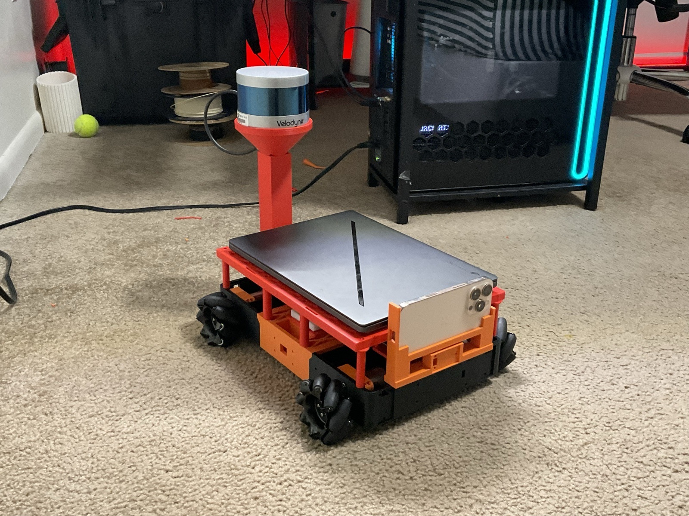
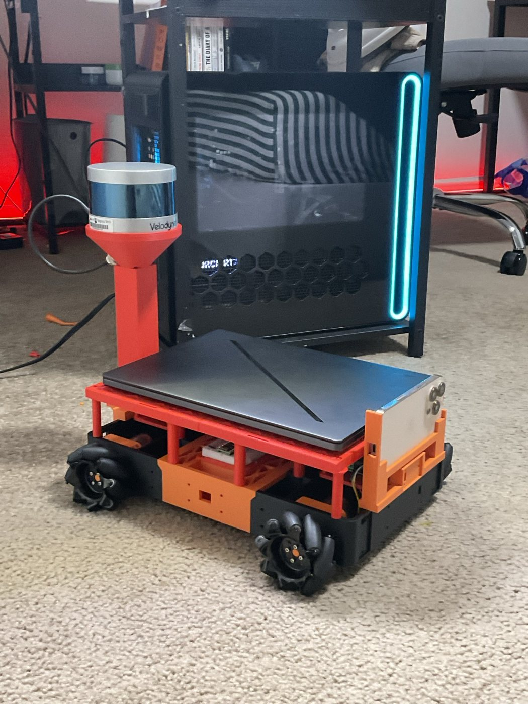
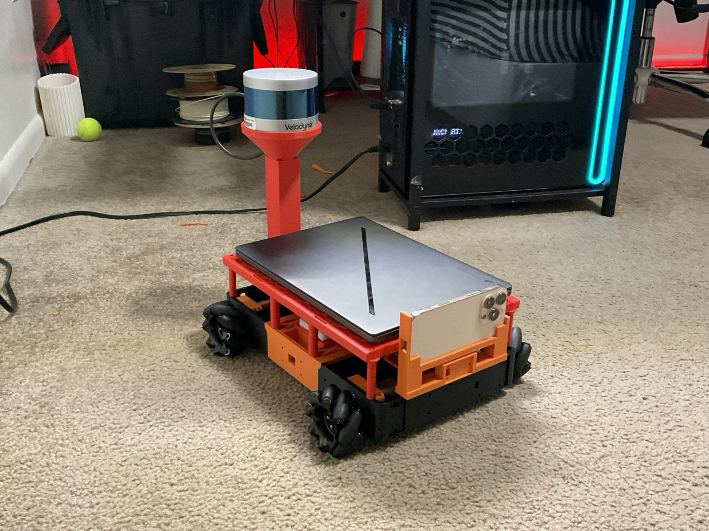
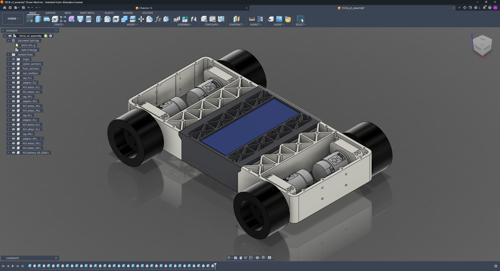

# Mini Tesla — Autonomous Electric Robot Platform

> **A miniature autonomous electric vehicle built to explore perception, navigation, rapid obstacle response, and regenerative braking.**

<p align="center">
  
</p>

<p align="center"><i>The printed Mini Tesla prototype: mecanum drivetrain, laptop deck, phone mount and a Velodyne LiDAR.</i></p>

## Members

**Daksh Gupta** — Computer Engineering, Virginia Tech  
Project Lead / Robotics & Embedded Systems  
mailtodaksh@vt.edu

## Mentor

**Virginia Tech AMP Lab**

## Current Status

🚧 **In Progress — CAD complete (FINAL rev 2), chassis printed, electronics and simulation underway**

The chassis CAD is complete and has passed its automated fit, interference and tool-path checks. A printed prototype is built and carrying the laptop deck, and the current focus is drivetrain and electronics bring-up while the robot is modelled in simulation (Gazebo Harmonic, ROS 2 Jazzy) in parallel.

| Area | Status |
|---|---|
| Mechanical CAD | Done: FINAL rev 2, see [CAD Files](CAD%20Files/README.md) |
| Gazebo simulation | Started: URDF, sensors, mecanum drive and test arena in [`ros_ws`](ros_ws/src/mini_tesla_description/README.md) |
| Printing / assembly | In progress: PLA prototype printed on a Prusa MK4S; tolerance coupon and final material still open |
| Firmware / autonomy | Not started |

---

## Gallery

<p align="center">
  
</p>

<p align="center"><i>Printed prototype, side view.</i></p>

<p align="center">
  
</p>

<p align="center"><i>10C4I FINAL rev 2: current chassis CAD assembly with laptop deck, ToF pods, radar and OAK-D mount.</i></p>

<p align="center">
  
</p>

<p align="center"><i>FINAL rev 2: isometric, side, top and exploded views.</i></p>

<p align="center">
  
</p>

<p align="center"><i>Earlier iteration (v2): three-section X-ribbed chassis before the laptop deck and side extensions. The full design history is in the <a href="CAD%20Files/README.md">CAD write-up</a>.</i></p>

---

## Project Overview

**Mini Tesla** is a custom four-wheel robotic EV platform designed to combine autonomous robotics with an experimental regenerative-braking drivetrain.

The robot is being built to:

- navigate autonomously using **ROS 2**
- localize using **stereo vision, wheel odometry, and IMU data**
- detect nearby obstacles using **stereo depth, ToF sensors, and radar**
- react rapidly to unexpected objects in its path
- perform higher-level **object and person detection**
- explore unknown spaces with **Active SLAM** and build **semantic maps** of what it sees
- **predict the trajectory of moving objects** (for example a thrown football) and brake or evade before impact, using predictive motion planning / MPC
- measure energy recovered during **regenerative braking**
- operate in both **manual and autonomous modes**
- validate algorithms in **Gazebo and NVIDIA Isaac Sim**

The long-term goal is a fully integrated autonomous vehicle that can perceive, decide, move, stop safely, and provide real experimental data about its braking and energy-recovery performance.

---

## Educational Value Added

Mini Tesla brings several areas of engineering together in one physical platform:

**Mechanical Design** — Modular chassis design, drivetrain integration, sensor mounting, structural design, and additive manufacturing.

**Embedded Systems & Controls** — Motor control, encoder feedback, real-time control, sensor interfaces, and communication between the low-level controller and autonomy computer.

**Autonomous Robotics** — ROS 2, localization, SLAM/VSLAM, path planning, sensor fusion, and autonomous navigation.

**Computer Vision & Perception** — Stereo depth, object detection, obstacle detection, and environmental understanding.

**Power Electronics** — Motor driving, braking behavior, electrical power measurement, and regenerative-energy experiments.

**Simulation** — Testing robot behavior in Gazebo and NVIDIA Isaac Sim before deploying changes to hardware.

---

## Current Tasks

- [x] Complete full mechanical CAD assembly
- [x] Finalize modular chassis and drivetrain mounting
- [x] Finalize camera, ToF, radar, and electronics placement
- [x] Build the Gazebo model (URDF, sensors, mecanum drive, test arena)
- [ ] Print the tolerance coupon and pick the final material
- [ ] Print and assemble the first complete chassis prototype
- [ ] Integrate motors, encoders, motor drivers, and Teensy 4.1
- [ ] Bring up low-level motion control
- [ ] Integrate the perception sensors
- [ ] Implement localization and autonomous navigation
- [ ] Develop rapid obstacle-response behavior
- [ ] Test and measure regenerative braking
- [ ] Build the final integrated autonomous demonstration

---

## Key Design Decisions

**Mecanum Drivetrain**  
The robot uses four independently driven mecanum wheels with **Pololu #4691 19:1 37D gearmotors with encoders** driving REV 75 mm mecanum wheels, allowing forward, lateral, diagonal, and rotational motion while retaining encoder feedback for closed-loop control and odometry.

**Regenerative Braking**  
Regenerative braking is one of the project's main experiments. The drivetrain and power electronics are being designed so braking events can be measured for recovered voltage, current, energy, stopping distance, and response time.

**Laptop-Based Compute**  
A sufficiently capable laptop is used as the primary onboard compute platform for ROS 2, perception, navigation, and higher-level autonomy. The software is not tied to a specific laptop model; the current deck is sized for an ASUS Zephyrus G14 (311 × 220 × 16.3 mm).

**Teensy 4.1 Low-Level Controller**  
The Teensy handles time-sensitive motor, encoder, and actuator control while the laptop handles higher-level autonomy.

**Multi-Sensor Perception**  
The perception stack combines an **OAK-D Lite**, close-range **Time-of-Flight sensors**, an **IMU**, wheel encoders, and a forward-facing **TI mmWave radar**. Each sensor covers a different part of the perception problem instead of relying on a single sensor. The current printed prototype also carries a **Velodyne LiDAR** on a printed mast and an **iPhone Pro** in the front mount, which is being investigated as an RGB-D (camera + LiDAR) sensor streamed into ROS 2.

**Modular Chassis**  
The chassis is designed as a serviceable, multi-part 3D-printed structure (three bolted sections that fit a Prusa MK4S bed, plus side extensions and a two-half laptop deck) with removable motor and sensor modules. Early prototypes use PLA, with PETG or PA612-CF planned for later revisions.

---

## BOM + Major Components

| Component | Role | Qty |
|---|---|---:|
| Pololu #4691 19:1 37D Gearmotor + Encoder | Drivetrain | 4 |
| REV 75 mm Mecanum Wheel | Drivetrain | 4 |
| Cytron Dual-Channel Motor Driver | Motor Control | 2 |
| Teensy 4.1 | Low-Level Control | 1 |
| OAK-D Lite | Stereo Vision / Depth | 1 |
| Time-of-Flight Sensors | Close-Range Obstacle Detection | 8 |
| TI IWR6843AOPEVM | Forward mmWave Radar | 1 |
| IMU | Motion Estimation | 1 |
| 6S 5200 mAh Battery + Power Electronics | Power System | 1 set |
| Custom 3D-Printed Chassis | Structure | 1 |

**Project budget target:** approximately **$1,700** for the complete platform.

---

## Timeline

### Milestone 1 — Physical Platform
**Current focus**

Complete the chassis, motor mounts, wheel integration, sensor mounts, electronics layout, and physical prototype assembly.

### Milestone 2 — Drive & Sensor Integration

Bring up the drivetrain, encoders, Teensy control, sensor interfaces, manual driving, odometry, and initial regenerative-braking tests.

### Milestone 3 — Autonomous Vehicle

Integrate localization, perception, navigation, obstacle response, regenerative-braking experiments, simulation, and the final autonomous demonstration.

---

## Software & Tools

| Area | Technologies |
|---|---|
| Robotics | ROS 2 Jazzy, Nav2 |
| Simulation | Gazebo Harmonic, NVIDIA Isaac Sim |
| Vision | OAK-D / DepthAI, OpenCV |
| Embedded | Teensy 4.1, C/C++ |
| Autonomy | SLAM, VSLAM, Sensor Fusion, Path Planning |
| Mechanical Design | Fusion 360 / SolidWorks |
| Development | Python, C++, Linux, Git/GitHub |

---

## Repository Layout

| Path | Contents |
|---|---|
| [`CAD Files/`](CAD%20Files/README.md) | 10C4I chassis design write-up, preview render and STEP assembly |
| [`ros_ws/src/mini_tesla_description/`](ros_ws/src/mini_tesla_description/README.md) | ROS 2 package: URDF/xacro, meshes, Gazebo Harmonic sim, launch files |
| `photos/` | Photos of the printed prototype |
| `hero.png`, `old.png` | CAD renders (FINAL rev 2 and the earlier v2 iteration) |

Quick start for the simulation (ROS 2 Jazzy + Gazebo Harmonic):

```bash
cd ros_ws && colcon build --packages-select mini_tesla_description && source install/setup.bash
ros2 launch mini_tesla_description sim.launch.py
```

---

## Useful Links

- [Project Portfolio](https://advanceuser2005.github.io/)
- [GitHub Profile](https://github.com/AdvanceUser2005)
- [ROS 2 Documentation](https://docs.ros.org/)
- [Nav2 Documentation](https://docs.nav2.org/)
- [NVIDIA Isaac Sim](https://developer.nvidia.com/isaac-sim)
- [DepthAI / OAK Documentation](https://docs.luxonis.com/)
- [Teensy 4.1](https://www.pjrc.com/store/teensy41.html)

---

## Project Log

### October 2026

- Printed PLA prototype assembled (Prusa MK4S) with mecanum wheels, laptop deck, phone mount and a Velodyne LiDAR; photos added to the repo.
- Current Mini Tesla architecture finalized around a four-wheel mecanum autonomous EV platform.
- Mechanical CAD is being redesigned around the actual purchased components and their supplied geometry.
- Chassis architecture moved toward a modular, multi-part printed design for easier manufacturing and service.
- Separate removable motor mounts selected instead of integrating the motors directly into the chassis.
- OAK-D Lite, ToF sensors, IMU, wheel encoders, and mmWave radar selected for the perception stack.
- Laptop-based onboard compute selected for the current autonomy stack.
- Teensy 4.1 selected for low-level real-time control.
- Regenerative braking remains a core experimental objective of the platform.
- 10C4I FINAL rev 2 completed (Oct 5): side extensions added so the ToF and radar fields of view clear the wheels; CAD passed interference, motion-path, tool-path and printability checks.
- Gazebo Harmonic simulation started (Oct 6): URDF from the CAD, 8 ToF, radar, OAK-D and IMU models, mecanum drive and a 6 × 6 m test arena.
- Current priority: **print the tolerance coupon and first chassis prototype, and move into physical integration.**

---

> **Mini Tesla is an active development project.** Capabilities described above represent the intended platform and are being implemented progressively as each subsystem is completed.
